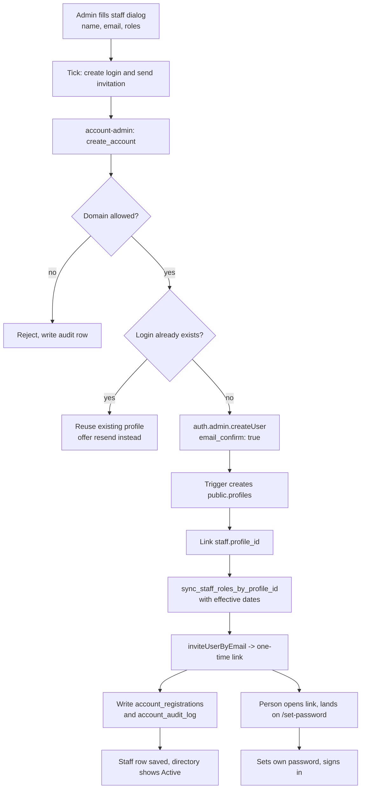

# Manual staff account system

## Why

The app can create a staff directory row but cannot create a login. Auth users only appear via Google
sign-in or by hand in Supabase Studio, and role grants are keyed on `profile_id`, so a staff record
with no linked profile silently discards every ticked role while still reporting success
(`src/pages/Admin.tsx:427`). This plan closes that gap: an admin creates a staff member, their
login, and their roles in one action, and the new person receives a one-time link to set their own
password.

## Decisions (settled)

| Decision | Choice |
|---|---|
| Credential delivery | Supabase invitation link; the user sets their own password. No password is ever generated, emailed, or displayed. |
| UI location | Extend the existing `/admin` page. No new route for management. |
| Domain rule | Configurable allowlist in `app_settings`, empty list = allow any. Enforced server-side. |
| Revocation | Explicit action: all role rows `active=false` plus the auth account banned. Reversible. `staff.status` stays an HR field and is not access control. |
| Password reset | In scope. Self-service recovery link plus a set-password screen. |
| Adjacent fixes | All four: staff RLS tightening, null-email guard in `handle_new_user`, silent role-drop warning, effective-date enforcement. |
| Extras | Audit log, resend invite from the UI, account status column in the directory table. |
| Outbound mail | Document the SMTP setup with placeholders. Local dev uses Inbucket on port 54324. |

## Target flow

## Tasks

### 1. Migration — `supabase/migrations/20260930000000_manual_account_system.sql`

New tables, all RLS enabled:

- `public.app_settings` — single row, `allowed_email_domains text[] not null default '{}'`, seeded with
  `insert ... on conflict do nothing`. Policy: `select` for `authenticated` (read-only), no write policies.
  Empty array means any domain is accepted.
- `public.account_registrations` — `profile_id` primary key referencing `profiles(id)` on delete cascade,
  `status text check (status in ('invited','active','revoked'))`, `created_by`, `invited_at`, `invite_sent_at`,
  `last_reinvited_at`, `revoked_at`, `revoked_by`, `notes`, timestamps.
  Policy: `select` for `is_access_admin`; no client write policies (the edge function writes via service role).
- `public.account_audit_log` — `id bigint generated always as identity primary key`, `profile_id`,
  `actor_id`, `actor_email`, `action text` checked against
  `create | resend_invite | revoke | restore | role_change | domain_rejected | create_failed`,
  `detail jsonb`, `created_at`. Index on `(profile_id, created_at desc)`.
  Policy: `select` for `is_access_admin`; no client write policies.

Schema fixes in the same migration:

- **Guard the profile trigger.** Recreate `public.handle_new_user()` with an early return when
  `new.email` is null or blank (today it inserts into a `not null` column and the auth insert fails),
  and add `on conflict (id) do nothing` for idempotency.
- **Tighten the staff write policy.** Drop `"Authenticated users can manage staff"` and replace with
  `"Access admins can manage staff" ... using (public.is_access_admin(auth.uid()))`.
  **Keep** `"Authenticated users can view staff"` for select — teacher and property-staff ticket
  assignee dropdowns read `staff` (`src/pages/Tickets.tsx:125-168`), so restricting reads would break them.
  Add a comment stating why select stays open.
- **Drop the unused `public.sync_staff_roles_by_email`** (`20260911000001_sync_staff_roles_rpc.sql:1`).
  No client or function references it.

RPC changes:

- `public.list_staff_directory()` — must be **dropped and recreated**, not `create or replace`, because
  Postgres refuses a changed return type. Add `account_status` and `account_invited_at` to the return
  table, left-joined to `account_registrations`. Derivation in SQL: no linked `profile_id` → `'none'`;
  otherwise `coalesce(ar.status, 'active')`.
- `public.sync_staff_roles_by_profile_id(p_profile_id uuid, p_roles text[])` — drop and recreate with a
  new signature accepting dated grants, e.g.
  `p_grants jsonb` where each element is `{"role": text, "effective_from": date|null, "effective_to": date|null}`.
  Keep the `is_access_admin(auth.uid())` guard and the existing soft-grant semantics: deactivate roles no
  longer granted, insert or revive the latest matching row otherwise. Match rows on
  `(profile_id, role, effective_from)` to respect the existing unique constraint.
  Keep `p_roles text[]` as a thin wrapper overload if that keeps the diff smaller, otherwise drop it and
  update the single client caller.
- `public.resolve_profile_id_by_email(p_email text)` — unchanged.

### 2. Edge function — `supabase/functions/account-admin/`

New folder with `index.ts` and a test file. Model the auth layer on
`supabase/functions/finance-intake/auth.ts`: resolve the caller from the `Authorization` header with
`supabase.auth.getUser(token)`, read roles from `user_roles`, and refuse rather than downgrade.

**Critical implementation detail.** The role RPCs gate on `auth.uid()`. A plain service-role client
resolves `auth.uid()` to null, so `is_access_admin(null)` is false and every RPC raises
`insufficient_privilege`. Build **two** clients:

- `authClient` — service role, no forwarded header. Used only for `auth.admin.*`.
- `dbClient` — service role with `global.headers.Authorization` set to the caller's bearer token,
  exactly as `supabase/functions/send-incident-email/index.ts:47-50` does. Used for PostgREST and RPC
  calls, so `auth.uid()` is the real admin and `granted_by` records who actually made the change.

Every action requires `is_access_admin` (`site_admin` or `it_admin`), matching `canAccessRoute("/admin")`
in `src/lib/role-tier.ts:153`. Add `[functions.account-admin] verify_jwt = true` to
`supabase/config.toml` so the gateway rejects anonymous callers before the function runs.

Actions, all `POST { action, ... }`:

- `create_account` — `{ email, firstName, lastName, grants, staffId? }`.
  1. Validate the domain against `app_settings.allowed_email_domains`; on failure write a
     `domain_rejected` audit row and return 400.
  2. Resolve an existing profile by email (service-role query on `profiles`, mirroring
     `resolve_profile_id_by_email` but without the admin gate since the service role bypasses RLS).
  3. If no profile exists, call `authClient.auth.admin.createUser({ email, email_confirm: true })`.
     On an "already registered" error, recover the id with a bounded paginated `admin.listUsers`
     scan filtered by email. GoTrue has no get-user-by-email endpoint; document this and the O(n) cost
     in a comment. If the id still cannot be found, write `create_failed` and return 409.
  4. Upsert `account_registrations` with `status = 'invited'`, `invited_at`, `invite_sent_at`, `created_by`.
  5. Link `staff.profile_id` when a staff row with that email exists or `staffId` is supplied.
  6. Apply roles through `sync_staff_roles_by_profile_id` on `dbClient`.
  7. `authClient.auth.admin.inviteUserByEmail(email, { redirectTo })` where `redirectTo` is the app URL
     plus `/set-password`.
  8. Write a `create` audit row.
  Return `{ ok, profileId, created, invited }`.
- `resend_invite` — `{ profileId }`. Calls `inviteUserByEmail` again, updates `last_reinvited_at`, writes
  `resend_invite`. If Supabase refuses because the address is already confirmed, return a clear 409 telling
  the admin to use password reset instead. Do not silently swallow it.
- `revoke` — `{ profileId }`. Set every `user_roles` row for the profile to `active=false`, call
  `authClient.auth.admin.updateUserById(id, { ban_until: <far future> })`, set the registration to
  `revoked` with `revoked_at`/`revoked_by`, write a `revoke` audit row.
- `restore` — `{ profileId }`. Call `updateUserById(id, { ban_until: null })` and set the registration to
  `active`. **Do not reactivate roles** — access must be re-granted explicitly so it never returns silently.

### 3. Client API — `src/lib/api/supabaseApi.ts`

- Add `createStaffAccount`, `resendStaffInvite`, `revokeStaffAccess`, `restoreStaffAccess`, and
  `fetchAccountAudit(profileId)`, each delegating to `invokeEdgeFunction("account-admin", ...)`.
- Add `fetchAccountSettings()` reading `app_settings` directly (RLS permits authenticated select).
- Change `replaceStaffRolesByProfileId` to send dated grants.
- Change `fetchCurrentUserRoles` (line 535) to select `effective_from`/`effective_to` and filter to
  rows where `effective_from is null or <= today` and `effective_to is null or >= today`. Note that
  `google-workspace-sync/index.ts:249` and `send-incident-email/index.ts:68` already do this filtering;
  `supabaseApi.ts:340` (directory roles) and `supabaseApi.ts:1839` (analytics counts) do not and should
  be updated for consistency.

### 4. Auth screens

- `src/pages/Login.tsx` — add a "Forgot password" link revealing an inline email field that calls
  `supabase.auth.resetPasswordForEmail(email, { redirectTo: getAppUrl() + "/set-password" })`. Always
  show the same neutral confirmation regardless of whether the account exists.
- New `src/pages/SetPassword.tsx` — registered in `src/App.tsx` as a **public** route beside `/login`,
  outside `ProtectedRoute` and `RouteGuard`. It relies on `detectSessionInUrl: true`
  (`src/lib/supabaseClient.ts:26`) to exchange the one-time code. If there is no session after loading,
  show "This link has expired or has already been used" rather than an empty form. On submit call
  `supabase.auth.updateUser({ password })`, confirm, then navigate to `/`. Accessible labels, visible
  focus, and a clear password rule message.

### 5. Admin UI — `src/pages/Admin.tsx`

- Staff dialog — add an Account block visible only when `isAdmin`: a checkbox to create a login and send
  the invitation, plus read-only text for the current domain rule from `fetchAccountSettings()`.
- Rework `handleSubmitStaff` (line 401) ordering: when creating an account, call the edge function first
  so a `profile_id` exists, then create or update the staff row with that id, then apply roles. Keep the
  existing RPC path for staff who already have a profile.
- Replace the silent drop at line 427 with an explicit warning toast naming the people whose roles could
  not be saved because no login matched their email address.
- Role grid — add optional "From" and "To" date inputs per ticked role, passed through to the RPC.
  Without these, honouring `effective_from`/`effective_to` on read would be a no-op.
- Selected-staff detail panel (around line 767) — add an account status badge and, for `isAdmin` only,
  Resend invite, Revoke access, and Restore access buttons with a confirmation step for revoke. Show the
  last 10 audit rows for that person.
- Directory table — add an "Account" column using `TableBadge` with the existing `getRoleBadgeTone`
  style: No login / Invited / Active / Revoked.

### 6. Tests

Add `supabase/functions/account-admin/account-admin.test.ts` following the fake-client pattern in
`supabase/functions/finance-intake/finance-auth.test.ts`, and add the file to the `test` script in
`package.json`. Cases: missing token → 401; signed-in user without an admin role → 403; non-allowlisted
domain → rejected and audited; a successful create issues exactly one invite, upserts one registration,
and writes one audit row; the role RPC is called through the header-forwarding client; revoke
deactivates roles and sets a ban; restore lifts the ban without reactivating roles.

### 7. Configuration

`supabase/config.toml`:
- Add `[functions.account-admin] verify_jwt = true`.
- Uncomment the `[auth.email.smtp]` block with placeholder `host`, `port`, `admin_email`, and
  `sender_name`, keeping `pass = "env(SENDGRID_API_KEY)"`. No real credential in the repo.
- Add a comment that `[auth.rate_limit] email_sent = 2` caps local invite and reset testing, and that it
  can be raised temporarily for development.

Document, without committing secrets:
- Set `SENDGRID_API_KEY` (or the chosen provider's key) in the environment.
- `supabase secrets set` the value for hosted deployments.
- Add the app origin to `additional_redirect_urls` if `/set-password` needs to be an explicit redirect.

Note: this project already has an outbound mail path for app-composed email via the
`EMAIL_WEBHOOK_URL` webhook in `supabase/functions/send-incident-email/index.ts:156`. The account flow
deliberately does not use it, because only Supabase's own auth mailer can mint a valid one-time link.
Record that reasoning in a code comment so the two mail paths do not get conflated later.

## Validation

1. `supabase db reset` locally, then confirm the trigger still fires and the new tables have RLS with the
   intended policies.
2. `npm run build`, `npm run lint`, `npm run test`.
3. End to end in the local stack: sign in as `site_admin`, create a staff member with two roles and one
   dated role, tick account creation, then read the invitation from Inbucket on port 54324. Open the
   link, set a password, sign in, and confirm the dated role is absent until its start date.
4. Confirm the silent-drop warning fires for a staff row whose email matches no login.
5. Revoke, confirm sign-in is refused and the directory shows Revoked, then restore and confirm the ban
   lifts while roles stay off.
6. Confirm a teacher can still open ticket assignee dropdowns, proving the staff select policy change
   did not break `src/pages/Tickets.tsx`.
7. Confirm password reset end to end through Inbucket.

## Risks and out of scope

- Recovering an existing user id requires a bounded `admin.listUsers` scan. Acceptable at school scale,
  but it is the weakest part of the design and should be revisited if the user count grows.
- Supabase may refuse a repeat invitation for an already-confirmed address. The plan surfaces this as a
  409 with a pointer to password reset rather than hiding it.
- Google Workspace sync still creates staff rows without accounts. Unchanged: those people get an account
  on first Google sign-in.
- Out of scope: bulk provisioning, self-registration, MFA, SSO-only enforcement, email domain ownership
  verification, and the `effective_from`/`effective_to` fields on `class_staff_assignments`.
- Pre-existing and unchanged: deleting a staff row does not revoke access. Revocation is now explicit,
  but the delete path still does not call it. Worth a follow-up decision.
